# CSCC11 Machine Learning

Regression, clustering, classification and recommendation algorithms written from their
definitions in NumPy, without library implementations, and each checked against an
independent reference. The experiments run them on real data and write every figure and number
below.

## Results at a glance

| Algorithm | Data | Result |
|---|---|---|
| Linear regression (least squares) | Graduate admissions, 400 applicants | Test MSE 0.00465, R² 0.80; five times better than predicting the mean |
| RBF regression for image inpainting | Photographs with text painted over them | 27.8 dB on the filled pixels, against 5.2 dB with the text left in |
| K-means (Lloyd's algorithm, restarts) | 427 × 640 photograph | 16 colours: 27.5 dB, file 3.7× smaller (7.5× as a palette image) |
| Gaussian mixture (EM, full covariances) | Same photograph | Matches scikit-learn from the same starting point; 23.8 dB at 16 components |
| Logistic regression (gradient descent) | Breast cancer, 569 tumours | 96.5% test accuracy, AUC 0.988; weights equal scikit-learn's to 10⁻⁶ |
| Naive Bayes (binary features) | BBC news, 2,225 articles, 5 classes | **96.0%** test accuracy (96.2% ± 0.4 over 20 splits) |
| Gaussian class conditionals | Same | **95.5%** test accuracy |
| k-NN, cross-validation, PCA | RAVDESS speech, 768 clips | **83.5%** test accuracy (81.4% ± 2.4 over 20 splits); 71.5% on unseen speakers |
| Support vector machine (SMO, linear and RBF kernels) | Handwritten digits, 1,797 images, 10 classes | **99.1%** test accuracy; every prediction equal to scikit-learn's |
| AdaBoost (decision stumps) | Breast cancer, 569 tumours | 95.9% test accuracy with 300 stumps, 88.3% with one (97.1% ± 1.1 over 20 splits with 100 stumps) |
| Neural network (backpropagation, one hidden layer) | Handwritten digits | 96.5% test accuracy; 95.7% without the hidden layer |
| Collaborative filtering (matrix factorization, ALS) | MovieLens, 100,000 ratings | Test RMSE **0.913** ± 0.008 over five splits; 0.941 with user and item offsets only |

## Image inpainting with RBF regression

Each colour channel of a small patch is treated as a function of pixel position and
fitted with radial basis functions on the pixels that are known; the fit is then
evaluated at the missing pixels. Text is painted over two clean photographs so that the
result can be compared with the original. PSNR is measured on the filled pixels only.

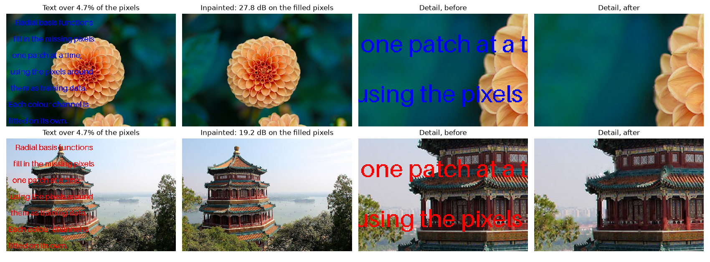

| | flower.jpg (smooth) | china.jpg (fine detail) |
|---|---|---|
| With the text | 5.19 dB | 4.95 dB |
| Inpainted (spacing 3, width 2, regularization 0.5) | **27.78 dB** | **19.25 dB** |
| Best of 81 settings | 28.18 dB (spacing 2, width 2) | 19.38 dB (spacing 3, width 3) |

What the three hyperparameters do, measured on flower.jpg (regularization 0.5 unless stated):

- **Spacing between centers.** Closer centers follow finer detail. With width 1 the PSNR
  falls from 26.4 dB at spacing 2 to 20.3 dB at spacing 6: bumps much narrower than the
  gaps between them leave holes where the model falls back to its bias.
- **Width.** It has to be judged against the spacing. At spacing 3, width 1 gives 24.9 dB,
  width 2 gives 27.8 dB and width 6 gives 25.8 dB: too narrow leaves holes, too wide makes
  neighbouring bumps almost identical and over-smooths.
- **Regularization.** It matters most when the fit is poorly determined: at spacing 2 and
  width 1, going from 0.001 to 0.05 lifts the result from 22.2 to 26.5 dB. At spacing 3
  and width 2 the three values are within 1.1 dB of each other.
- **Limit of the method.** On the detailed photograph the best setting reaches 19.4 dB. A
  sum of smooth bumps cannot recreate roof tiles or foliage it has not seen.

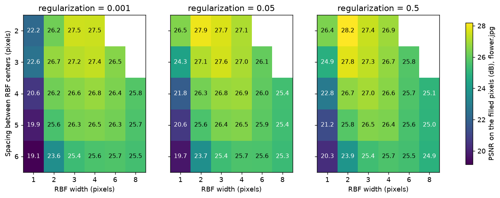

## Colour quantization with K-means and a Gaussian mixture

Each pixel is a point in colour space. The pixels are clustered into K groups and every
pixel is replaced by the centre of its group.

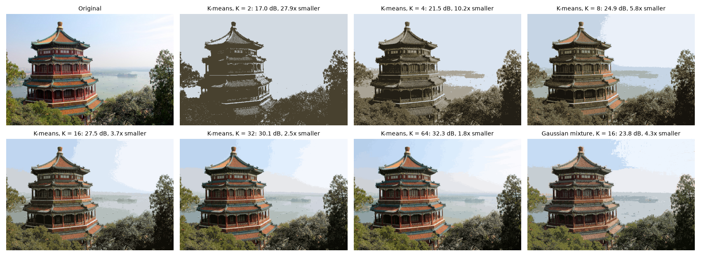

| K | PSNR (K-means) | 24-bit PNG | Palette PNG | PSNR (mixture) |
|---|---|---|---|---|
| 2 | 17.04 dB | 27.9× smaller | 54.5× smaller | 15.65 dB |
| 4 | 21.54 dB | 10.2× | 17.4× | 19.74 dB |
| 8 | 24.90 dB | 5.8× | 10.1× | 20.61 dB |
| 16 | 27.54 dB | 3.7× | 7.5× | 23.78 dB |
| 32 | 30.07 dB | 2.5× | 6.5× | 27.03 dB |
| 64 | 32.26 dB | 1.8× | 5.1× | 28.62 dB |

- Each doubling of K brings the image 2.2 to 4.5 dB closer to the original.
- Storing one cluster index per pixel plus K colours (a palette PNG) is two to three
  times smaller than a 24-bit PNG of the same image at K ≥ 16.
- At the same K the mixture model is 1.4 to 4.3 dB further from the original. K-means
  minimizes exactly the squared error that PSNR measures; EM maximizes the likelihood,
  and the mean of a component is then not the best single colour for its pixels.

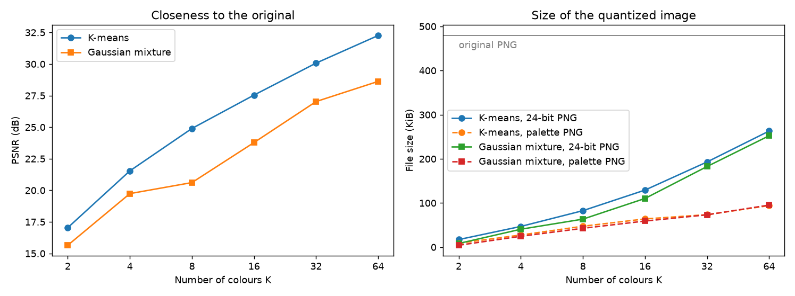

## Two Bayesian classifiers on news articles

2,225 BBC articles in five categories, described by 9,635 stemmed terms; 1,558 articles
for training and 667 for testing.

| Classifier | Training accuracy | Test accuracy | Test accuracy over 20 splits |
|---|---|---|---|
| Naive Bayes on whether each term occurs | 98.78% | **95.95%** | 96.15% ± 0.43 |
| Gaussian class conditionals on term counts, variance floor chosen by cross-validation | 99.68% | **95.50%** | 95.49% ± 0.53 |
| Gaussian, almost no variance floor (10⁻⁹) | 99.94% | 92.50% | |

- Whether a term occurs carries nearly all the information; how often it occurs adds little.
- A term that never occurs in a class has variance zero there, so the Gaussian classifier
  needs a variance floor, and its size decides the result: three points of test accuracy
  separate a negligible floor from the one chosen by 5-fold cross-validation.
- Most mistakes are between business, politics and tech, which share vocabulary.

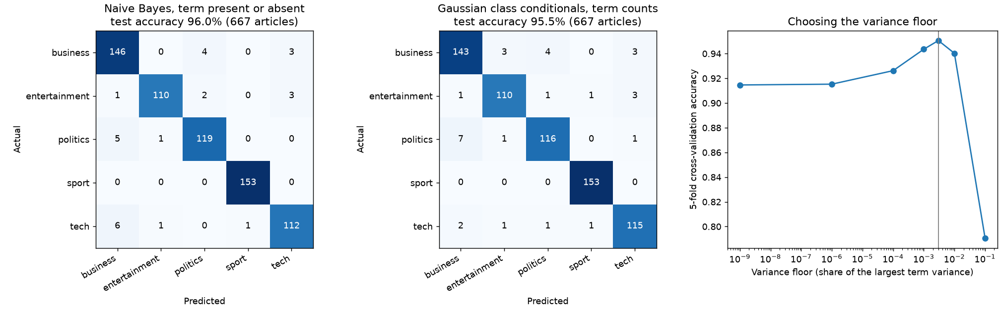

## Emotion in speech with k-NN, cross-validation and PCA

768 clips by 24 actors, positive (calm, happy) against negative (angry, fearful). Each
clip is described by 12 chroma values and 128 Mel band energies. k is chosen by 5-fold
cross-validation on the training set (538 clips) and the classifier is scored once on
the test set (230 clips). Scaling and PCA are fitted inside each fold.

| Features | Dimensions | k chosen | Test accuracy | Test accuracy over 20 splits |
|---|---|---|---|---|
| Mel energies, not scaled | 140 | 3 | 75.7% | 71.5% ± 1.8 |
| Mel energies, standardized | 140 | 1 | 74.3% | 69.9% ± 3.5 |
| Mel energies, PCA keeping 95% of the variance | 34 | 5 | 67.0% | 68.5% ± 2.4 |
| Log-Mel energies, standardized | 140 | 1 | **83.5%** | **81.4% ± 2.4** |
| Log-Mel energies, PCA keeping 95% of the variance | 16 | 1 | **83.0%** | 79.5% ± 2.5 |

- **The scale of the features matters more than k or PCA.** The Mel band energies span
  about ten orders of magnitude, so a Euclidean distance on them is decided by the few
  loudest bands. Taking their logarithm lifts the accuracy by 11.6 points.
- **PCA.** On the log-Mel features 16 of 140 dimensions explain 95% of the variance, and
  using only those costs about 2 points.
- **The choice of k is not well determined.** The cross-validation curves are flat within
  the spread over the folds, and the k chosen changes from split to split.
- **Voices the classifier has not heard.** In a random split every actor appears in both
  sets. Leaving four actors out at a time gives 71.5% ± 3.7, ten points lower: part of the
  random-split accuracy comes from recognizing the speaker.

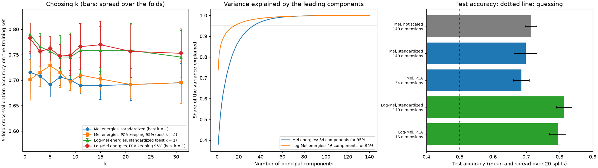

## Support vector machines

The dual problem is solved by sequential minimal optimization: each step changes the two
multipliers that violate the optimality conditions the most, and moves them to the best
point the constraints allow.

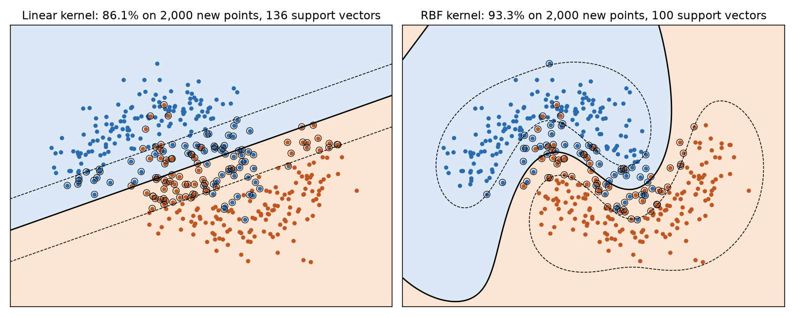

| Data | Kernel | Test accuracy |
|---|---|---|
| Two half-moons: 400 points to train on, 2,000 new ones | Linear | 86.1% |
| | RBF | 93.35% |
| Handwritten digits: 1,258 to train on, 539 to test, one machine per digit | Linear | 95.2% |
| | RBF | **99.1%** |

- A line cannot follow the half-moons. The RBF kernel can, and it needs fewer support
  vectors to do so (100 against 136).
- On the half-moons the decision values differ from scikit-learn's by at most 1.3 × 10⁻⁵.
  On the digits all 539 predictions are the same.
- The settings were fixed in advance, not tuned on the test sets: C = 1 and gamma = 1 for
  the half-moons, C = 10 and gamma = 1 / (64 × variance of the training pixels) for the digits.

## AdaBoost with decision stumps

Each round adds the one-feature threshold rule with the smallest weighted error, then
raises the weight of the points it got wrong. Same tumours and same 398 / 171 split as
the logistic regression below.

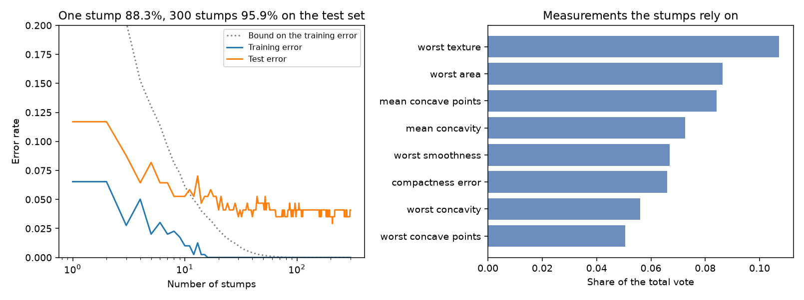

| Stumps | Training accuracy | Test accuracy |
|---|---|---|
| 1 | 93.5% | 88.3% |
| 10 | 99.0% | 94.7% |
| 100 | 100% | 95.9% |
| 300 | 100% | **95.9%** |

- The training error reaches zero at 16 stumps. The test error is 5.3% at that point and
  4.1% after 300: adding stumps beyond a perfect fit does not overfit here.
- Over 20 random splits, 100 stumps give 97.1% ± 1.1, so the split in the table is one of
  the harder ones.
- scikit-learn's AdaBoost with 300 depth-one trees also reaches 95.9% on this split. Given
  the same stumps, its boosting loop produces the same weighted errors and predictions.

## A neural network on handwritten digits

One hidden layer of 64 ReLU units and a softmax output, trained by backpropagation with
mini-batch gradient descent and momentum for 60 epochs. 1,797 images of 8 × 8 pixels,
1,258 to train on and 539 to test.

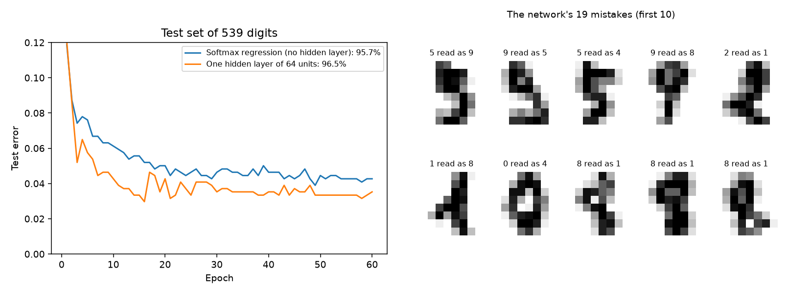

| Model | Training accuracy | Test accuracy |
|---|---|---|
| Softmax regression (the same code without a hidden layer) | 98.8% | 95.7% |
| One hidden layer of 64 units | 100% | **96.5%** |
| scikit-learn `MLPClassifier` with the same layer sizes | | 97.4% |
| RBF support vector machine (above) | | 99.1% |

- The network makes 19 mistakes; five of them are an 8 read as a 1.
- It fits the training set perfectly and is still 2.6 points behind the kernel machine:
  1,258 images are few for 4,810 parameters.
- The settings were fixed in advance. scikit-learn's network (Adam, its own initialization
  and stopping rule) is 0.9 points ahead, which is 5 digits.

## Collaborative filtering on film ratings

MovieLens 100K: 100,000 ratings from 1 to 5 stars, given by 943 people to 1,682 films. A
rating is modelled as the mean rating, plus an offset for the person, plus an offset for
the film, plus the product of two short vectors, one per person and one per film. The
model is fitted by alternating least squares: with the films fixed, each person's
numbers are the solution of a small ridge regression, and the other way round.

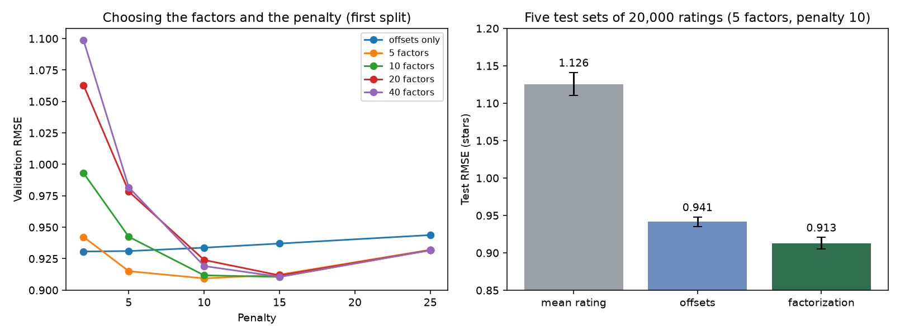

| Model | Test RMSE over the five predefined splits |
|---|---|
| The mean rating for everyone | 1.126 ± 0.016 |
| Offsets for people and films | 0.941 ± 0.007 |
| Matrix factorization with 5 factors | **0.913 ± 0.008** |

- The number of factors and the penalty were chosen on 8,000 ratings set aside from the
  training part of the first split. Each test set of 20,000 ratings was used once.
- A few factors are enough. At a penalty of 15, models with 5 to 40 factors are within
  0.002 of each other on the validation ratings.
- The penalty matters more than the size. With a penalty of 2, 40 factors give 1.099 on
  the validation ratings, worse than the offsets alone (0.931).

## Regression and the smaller experiments

**Linear regression.** Chance of admission from seven applicant features, 280 applicants
for training and 120 for testing: test MSE 0.004653 (RMSE 0.068 on a 0 to 1 scale),
against 0.023164 for predicting the training mean. Over 200 random splits the test MSE
is 0.004252 ± 0.000632, so a single split should not be read to three digits. CGPA
carries most of the prediction.

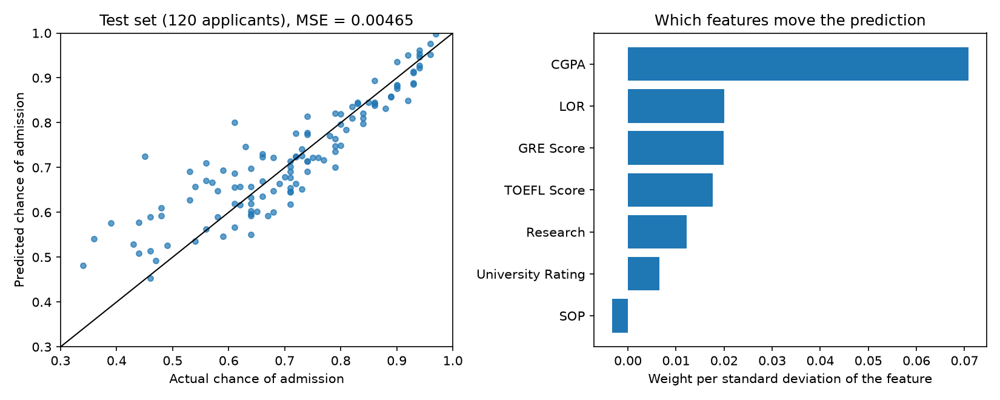

**Logistic regression.** Benign against malignant tumours from 30 measurements, 398 for
training and 171 for testing, with an L2 penalty. Gradient descent with step
1 / (curvature bound) lowers the objective at every update and reaches scikit-learn's
weights to within 10⁻⁶. Test accuracy 96.5%, AUC 0.988; 4 malignant tumours missed and
2 false alarms.

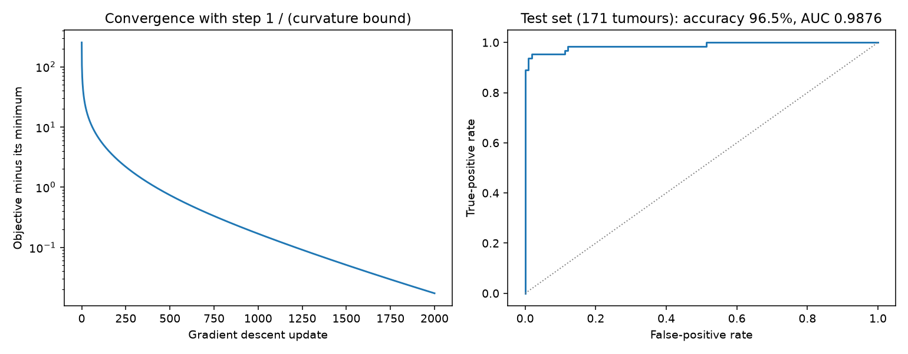

**Majority vote.** The error rate of N independent classifiers that each err with
probability ε is the upper tail of a binomial distribution. With ε = 0.3 it falls from
0.300 for one classifier to 0.163 for five and 0.026 for twenty-one; with ε above 0.5
voting makes things worse.

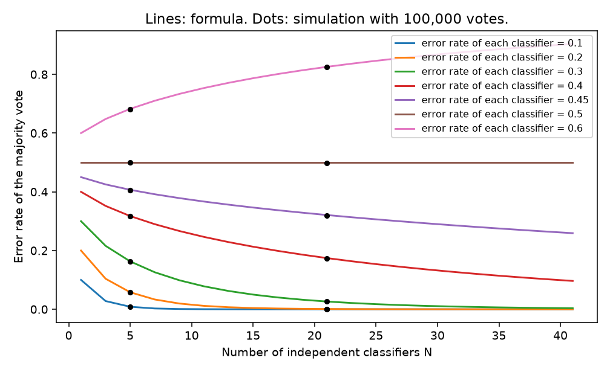

## How it is checked

`pytest` runs 131 tests. Each algorithm is compared with an independent reference, not
only with itself:

| Implementation | Reference |
|---|---|
| Linear regression | scikit-learn `LinearRegression`; the normal equations |
| RBF regression | Ridge regression on the same basis functions; zero gradient at the solution |
| Inpainting | Known clean images under a mask, including the image border and a steep ramp |
| K-means | scikit-learn `KMeans` from the same starting centroids |
| Gaussian mixture | scikit-learn `GaussianMixture` from the same starting point; SciPy for the density; the log-likelihood never decreases |
| Logistic regression | Finite differences for the gradient; one update worked by hand; scikit-learn for the optimum |
| Naive Bayes | A five-document example by hand; scikit-learn `BernoulliNB` on the BBC data |
| Gaussian classifier | The density formula; scikit-learn `GaussianNB` |
| k-NN | scikit-learn `KNeighborsClassifier` |
| Cross-validation | A manual loop over the same folds with the library k-NN |
| PCA | scikit-learn `PCA`: variances, directions up to sign, projections |
| Support vector machine | Two small problems by hand; the optimality conditions at the solution; scikit-learn `SVC`: decision values, support vectors, dual objective |
| AdaBoost | Exhaustive search for the best stump; three rounds by hand; scikit-learn's boosting loop given the same stumps |
| Neural network | Finite differences for every weight and bias; scikit-learn `LogisticRegression` for the network without hidden layers |
| Collaborative filtering | scikit-learn `Ridge` for one person's update; zero gradient after an update; hidden entries of a low-rank table |

## Running it

```bash
make setup      # virtual environment with the pinned packages
make test       # the test suite; the data set checks are skipped until `make data`
make data       # BBC news, RAVDESS speech and MovieLens ratings into data/ (214 MB, not committed)
make results    # regenerate every figure and number under results/
```

Or one experiment at a time, for example `python -m experiments.image_inpainting`.
Every random choice is seeded, so the numbers in `results/metrics.json` reproduce (the timings aside).

## Layout

```
cscc11/         linear_regression, rbf, inpainting, kmeans, gmm, logistic_regression, naive_bayes,
                gaussian_classifier, knn, pca, svm, adaboost, neural_network, collaborative_filtering,
                model_selection, voting, imaging, datasets
experiments/    one script per experiment; `python -m experiments` runs them all
tests/          one file per group of algorithms
results/        figures and metrics.json written by the experiments
scripts/        fetch_data.py
```

## Data

- Graduate admissions: M. S. Acharya, A. Armaan and A. S. Antony, "A Comparison of
  Regression Models for Prediction of Graduate Admissions", ICCIDS 2019.
- BBC news: D. Greene and P. Cunningham, "Practical Solutions to the Problem of Diagonal
  Dominance in Kernel Document Clustering", ICML 2006.
- RAVDESS: S. R. Livingstone and F. A. Russo, "The Ryerson Audio-Visual Database of
  Emotional Speech and Song", PLoS ONE 13(5), 2018 (CC BY-NC-SA 4.0).
- MovieLens 100K: F. M. Harper and J. A. Konstan, "The MovieLens Datasets: History and
  Context", ACM Transactions on Interactive Intelligent Systems 5(4), 2015.
- Breast cancer (Wisconsin Diagnostic), the handwritten digits (from the UCI Optical
  Recognition of Handwritten Digits data) and the two photographs ship with scikit-learn;
  the photographs are CC BY 2.0, by danielbuechele and vultilion on Flickr.
